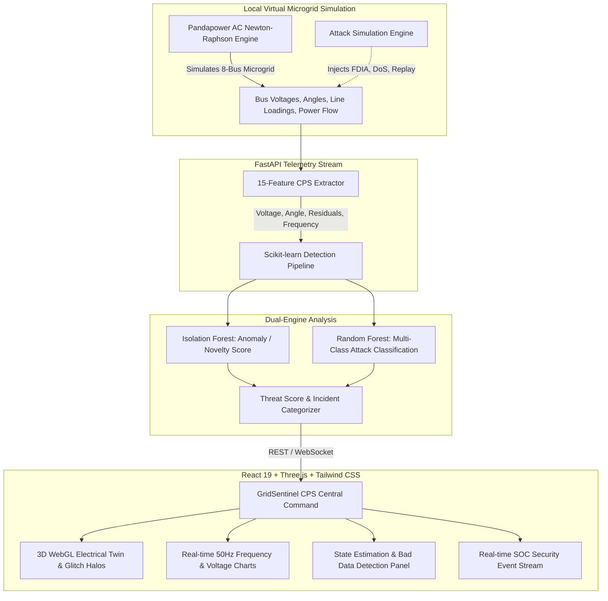

# GridSentinel AI ⚡🛡️
### AI-Powered Smart Grid & Microgrid Cybersecurity Platform
**Aligned with Problem Statement ID:** `DL-SJBIT-HK26-GOVP007`  
*Cyber-Security Enabled Smart Controller for Grid-Connected Microgrids*

---

## 📌 Executive Summary

Modern grid-connected microgrids integrate distributed energy resources (DERs)—such as solar photovoltaic (PV) arrays, wind turbine generators, and battery energy storage systems (BESS)—with industrial, medical, and residential critical infrastructure. However, reliance on digital communication networks and SCADA/Modbus/DNP3 protocols exposes the cyber-physical system (CPS) to sophisticated threats:
- **False Data Injection Attacks (FDIA)**: Stealthy measurement manipulation bypassing traditional state estimation Bad Data Detection (BDD).
- **Denial of Service (DoS)**: Telemetry latency and communication freeze inducing delayed protective trip responses.
- **Sensor Replay Attacks**: Recording and looping stale healthy measurements to mask physical degradation.
- **Coordinated Load Tampering**: Sudden concurrent load spikes inducing grid frequency collapse.
- **DER Disconnect/Trip Attacks**: Remote uncoupling of PV/BESS generation violating IEEE 1547 ride-through standards.

**GridSentinel AI** addresses these challenges by uniting **physics-based electrical modeling** (Pandapower AC Newton-Raphson power flow) with **dual-engine AI/ML cybersecurity** (unsupervised Isolation Forest + supervised Random Forest classifier) and an interactive **3D WebGL Digital Twin** for real-time situational awareness and rapid incident response.

---

## 🔒 Safety & Virtual Confinement Notice

> [!IMPORTANT]
> **Zero Hardware Connection / Pure Virtual Confinement:**
> All grid simulations and attack simulations in this repository are strictly confined to local virtual environments and mathematical state calculations. GridSentinel AI does not interface with, command, or transmit signals to any real-world electrical equipment, substation relays, circuit breakers, or SCADA networks.

---

## 🏛️ System Architecture



---

## 🚀 Key Features

### 1. 3D WebGL Electrical Grid Twin
- Interactive **Three.js** 3D model of the 8-node microgrid:
  - **Substation Slack Bus (69 kV)**
  - **Main Switchgear Bus (13.8 kV)**
  - **Solar PV Farm (4.16 kV)**
  - **Wind Turbine Facility (4.16 kV)**
  - **BESS (4.16 kV)**
  - **Hospital Critical Care Unit (0.48 kV)**
  - **Industrial Heavy Manufacturing (0.48 kV)**
  - **Residential Smart District (0.48 kV)**
- Real-time animated flowing power-flux particles.
- Dynamic line color gradients (Green: $<60\%$ loading, Amber: $60-85\%$, Red: $>85\%$ overload).
- Live cyber-attack pulsating glitch halos highlighting compromised nodes.
- One-click camera presets: **Isometric**, **Top-Down 2D**, **Solar PV Focus**, **Hospital Focus**.

### 2. Dual-Engine Scikit-learn AI Detection
- **15-Dimensional CPS Feature Vector**:
  - Voltage profile statistics: $V_{\min}, V_{\max}, \bar{V}, \sigma(V)$
  - Voltage angle spreads: $\Delta \theta_{\max}, \sigma(\theta)$
  - Grid frequency deviation: $|\Delta f| = |f - 50.00\text{ Hz}|$
  - Active and reactive power imbalances: $\sum P_{\text{gen}} - \sum P_{\text{load}}, \sum Q_{\text{gen}} - \sum Q_{\text{load}}$
  - Physics-based State Estimation residuals: normalized $J(x) = \|z - h(x)\|^2$
  - Kirchhoff's Current Law (KCL) bus injection conservation residuals
- **Models**:
  - **Isolation Forest**: Zero-day anomaly detection without labeled baseline attack bias.
  - **Random Forest Classifier**: Multi-class attack taxonomy classification.
  - **Persistent Model Artifact**: Persisted at `models_data/gridsentinel_ml_pipeline.joblib`.

### 3. Integrated Virtual Attack Lab
- Safe testbed for cyber-physical resilience testing:
  - **FDIA Voltage Tampering**: Biases voltage sensor measurements by $\pm 5\%$ to $\pm 25\%$.
  - **FDIA Power Injection**: Manipulates $P/Q$ telemetry to deceive automatic generation control.
  - **Telemetry DoS (Freeze)**: Simulates packet dropping or frozen SCADA telemetry buffers.
  - **Sensor Replay Attack**: Loops stale healthy historical telemetry to conceal active anomalies.
  - **Coordinated Load Surge**: Simulates demand manipulation inducing frequency degradation.
  - **DER Tripping**: Simulates unauthorized breaker opening of solar or storage units.
- Dedicated **Neutralize All** emergency kill switch.

### 4. Grid Telemetry, State Estimation & Waveforms
- Bus telemetry table displaying $V_m$ (p.u.), phase angle $\delta^\circ$, active power $P$ (MW), reactive power $Q$ (MVAr).
- State Estimation Bad Data Detection (BDD) with Chi-Square ($\chi^2$) hypothesis testing indicator.
- Real-time 50.00 Hz microgrid frequency tracking with IEEE Under/Over-Frequency trip limits.
- Multi-bus voltage profiles with $\pm 5\%$ ANSI C84.1 nominal boundaries ($[0.95, 1.05]$ p.u.).
- Generation vs Load dynamic area dispatch graph.

---

## 🛠️ Technology Stack

| Layer | Technologies |
| :--- | :--- |
| **Backend Framework** | Python 3.10+, FastAPI, Uvicorn, Pydantic v2 |
| **Power Systems Engine** | Pandapower (AC Newton-Raphson Power Flow) |
| **Cybersecurity AI/ML** | Scikit-learn (IsolationForest, RandomForest), NumPy, Joblib |
| **Database & Cache** | SQLite (SQLAlchemy 2.0 ORM), In-Memory Simulation State |
| **Streaming** | Native WebSockets (`/ws/telemetry`), RESTful API (`/api/v1`) |
| **Frontend Framework** | TanStack Start, Vite 8.1, React 19, TypeScript |
| **3D Graphics & Visuals** | Three.js (`three`), Lucide React icons |
| **Styling & Motion** | Tailwind CSS 4, Framer Motion 14 |
| **Charting** | Recharts 2.15 |

---

## 📂 Repository Structure

```
GridSentinel-AI/
├── app/                              # Modular FastAPI Backend
│   ├── main.py                       # FastAPI application entrypoint & lifespan
│   ├── core/                         # Core configuration, logging, exceptions
│   ├── database/                     # SQLite models, sessions, schema init
│   ├── grid_simulation/              # Pandapower 8-bus microgrid & power flow
│   ├── telemetry/                    # Telemetry collector & WebSocket stream
│   ├── attack_simulation/            # Virtual attack injection engine
│   ├── cybersecurity/                # 15-feature extractor & ML models
│   └── api/v1/                       # REST endpoints (health, grid, attacks, etc.)
├── models_data/                      # Persisted Scikit-learn ML pipelines
│   └── gridsentinel_ml_pipeline.joblib
├── tests/                            # Automated test suite
│   ├── test_health.py
│   ├── test_grid_simulation.py
│   ├── test_attacks.py
│   ├── test_cybersecurity.py
│   └── test_api.py
├── src/                              # Modern React 19 Frontend
│   ├── components/
│   │   ├── auth/                     # Animated login card & biometric scan
│   │   ├── dashboard/                # Telemetry, Waveforms, Attack Lab, SOC log
│   │   ├── galaxy/                   # 3D Rotating Galaxy welcome screen
│   │   ├── grid3d/                   # Three.js 3D Microgrid digital twin
│   │   └── layout/                   # AppShell navigation header
│   ├── routes/                       # Application pages
│   │   ├── index.tsx                 # Galaxy Welcome Portal
│   │   ├── login.tsx                 # Commander Identity Verification
│   │   ├── overview.tsx              # CPS Central Command Dashboard
│   │   ├── detections.tsx           # SOC Incident Forensic Triage
│   │   ├── decoys.tsx                # Dedicated Attack Simulation Deck
│   │   └── settings.tsx              # System & Standards Compliance
│   ├── lib/
│   │   └── api.ts                    # Backend client with demo fallback
│   └── config/
│       └── app.ts                    # Application metadata & endpoints
├── .env.example                      # Environment template
├── package.json                      # Frontend dependencies & scripts
├── requirements.txt                  # Python backend dependencies
└── README.md                         # Platform documentation
```

---

## 🚦 Getting Started

### 1. Prerequisites
- **Python 3.10+** (tested on Python 3.10, 3.11, 3.12, 3.14)
- **Node.js 18+** & **npm**

### 2. Backend Setup & Startup
```powershell
# Navigate to project root
cd C:\Users\DELL\Desktop\GridSentinel-AI

# Install Python dependencies
pip install -r requirements.txt

# Start FastAPI backend server
python -m uvicorn app.main:app --host 0.0.0.0 --port 8000 --reload
```
- API Documentation (Swagger UI): [http://localhost:8000/docs](http://localhost:8000/docs)
- Health Check: [http://localhost:8000/health](http://localhost:8000/health)

### 3. Frontend Setup & Startup
```powershell
# In a separate terminal in C:\Users\DELL\Desktop\GridSentinel-AI:
# (If node_modules is already linked, you can start immediately)
npm.cmd run dev
```
- Open your browser at: [http://localhost:3000](http://localhost:3000)

### 4. Running Backend Tests
```powershell
python -m pytest tests/ -v
```

---

## 🧭 Page Navigation Walkthrough

1. **Welcome Galaxy Portal (`/`)**:
   - 3D rotating starfield and particle banner: *GRIDSENTINEL AI // WELCOME TO THE GRID*.
   - Tactical HUD displays node uplink status (`GS // SECURE NODE 07`).
   - Click **INITIALIZE SYSTEM ⏻** or press **[ENTER]** to proceed.

2. **Commander Identity Verification (`/login`)**:
   - Dedicated identity card for `Commander Gowtham` (`NODE: SENTINEL-ALPHA`).
   - One-click **DEMO AUTO-FILL** for instant credentials.
   - Animated biometric authentication scan and automatic transition to the command center.

3. **CPS Central Command Dashboard (`/overview`)**:
   - Real-time KPI stat cards: Microgrid Frequency (Hz), Active Load (MW), Voltage Stability index, AI Anomaly Score.
   - Interactive 3D Microgrid twin with bus inspection details.
   - Integrated Attack Control Lab with real-time injection controls.
   - Real-time 50 Hz frequency waveform and multi-bus voltage charts.
   - State Estimation Bad Data Detection (BDD) residual indicators.
   - Live SOC event feed with one-click resolution.

4. **SOC Threat Triage & Event Logs (`/detections`)**:
   - Forensic log of all recorded cyber and physical incidents.
   - Severity filters (**All**, **Critical**, **High**, **Medium**, **Low**).
   - Export incident log as formatted JSON.

5. **Attack Simulation Deck (`/decoys`)**:
   - Full-featured testbed with parameters for all 6 cyber-attack vectors.
   - Intensity sliders, target selection, and countdown timers.
   - Verified zero-hardware isolation banner.

6. **System Settings & Compliance (`/settings`)**:
   - Live backend ping test with round-trip latency measurement.
   - IEEE 1547-2018, NERC CIP-005/007, and IEC 62351 regulatory compliance checklist.

---

## 📜 Compliance & Engineering References
- **IEEE 1547-2018**: Standard for Interconnection and Interoperability of Distributed Energy Resources with Associated Electric Power Systems Interfaces.
- **NERC CIP (005, 007)**: Critical Infrastructure Protection Standards for Electronic Security Perimeters and Systems Security Management.
- **IEC 62351**: Power systems management and associated information exchange - Data and communications security.

---

## 👥 Authors & Acknowledgments
- **Project**: GridSentinel AI
- **Problem Statement**: `DL-SJBIT-HK26-GOVP007`

